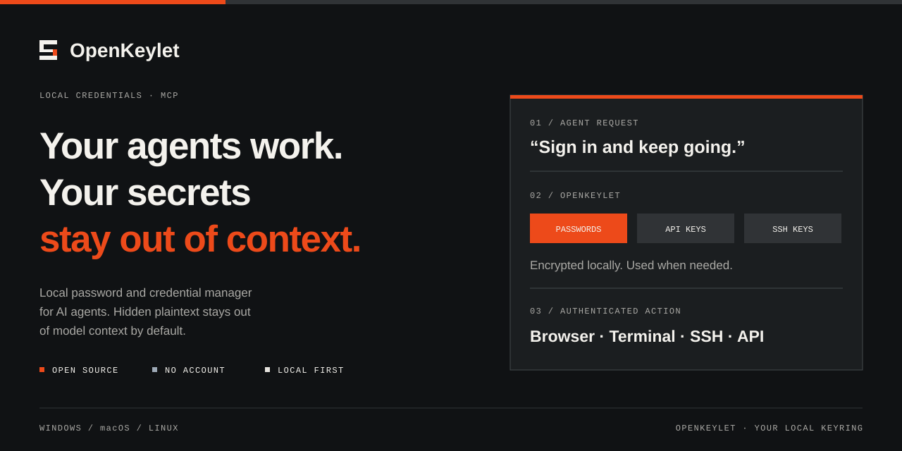
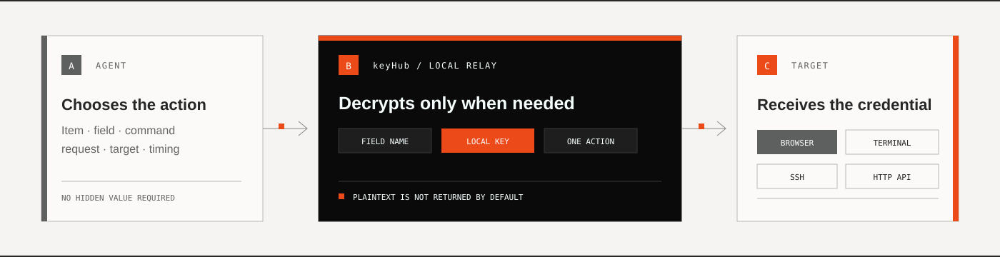

<p align="center">
  
</p>

<h1 align="center">OpenKeylet — Local password and credential manager for AI agents</h1>

<p align="center">
  <strong>A local MCP credential relay that keeps agent workflows moving without exposing hidden plaintext.</strong>
</p>

<p align="center">
  Local first&nbsp;&nbsp;·&nbsp;&nbsp;Free and open source&nbsp;&nbsp;·&nbsp;&nbsp;No OpenKeylet account&nbsp;&nbsp;·&nbsp;&nbsp;Windows / macOS / Linux
</p>

<p align="center">
  <a href="../../releases/latest"><strong>Download</strong></a>
  &nbsp;&nbsp;·&nbsp;&nbsp;
  <a href="README.zh-CN.md">中文</a>
  &nbsp;&nbsp;·&nbsp;&nbsp;
  <a href="SECURITY.md">Security</a>
</p>

---

OpenKeylet is a free, open-source, cross-platform password manager, credential vault, and local `stdio` MCP server for AI agents. It lets MCP clients such as Codex, Claude Code, Cursor, OpenCode, and OpenClaw use saved passwords, API credentials, SSH keys, TOTP codes, and custom secrets while hidden plaintext stays outside the normal model context.

Use OpenKeylet when an agent needs to sign in to a website, connect to a server, call an authenticated API, or finish a terminal prompt without asking you to paste a secret into the conversation.

**Previously KRU.** OpenKeylet keeps the same local vault, encryption keys, browser pairing, and `.mvault` backup format. Existing `{{kru:module}}` placeholders and `KRU_DATA_DIR` / `KRU_LAUNCHER_PATH` environment variables remain supported; use `{{openkeylet:module}}` and `OPENKEYLET_*` for new setups. After upgrading, open **Settings → Agent connection → Repair** to migrate a managed `kru` MCP entry to `openkeylet` and update its executable path, then start a new agent session. Existing desktop and startup shortcuts are migrated when the new GUI starts.

## Use OpenKeylet like this

Once OpenKeylet is connected, describe the task normally. Include the unique OpenKeylet item name for the most reliable match, or simply tell the agent to check OpenKeylet when authentication is needed.

| Goal | Example |
| --- | --- |
| **Server task** | `Use "Production Server" in OpenKeylet MCP to deploy the current build and verify the service.` |
| **Authenticated API** | `Use "DNS Provider" in OpenKeylet MCP to list the domains in this account.` |
| **Browser sign-in** | `Open the admin console. When credentials are required, use "Admin Account" in OpenKeylet MCP.` |
| **Automatic lookup** | `Continue the task. If authentication is required, check OpenKeylet first.` |

The quoted text is the item name saved in OpenKeylet. If you omit it, the agent can inspect OpenKeylet's item list and choose a match.

## What OpenKeylet does

OpenKeylet is a small local MCP tool for saving and using credentials without breaking an agent's workflow. The agent controls the task, while OpenKeylet performs credential operations locally—filling a focused field, running local or SSH commands, transferring files and directories, or sending authenticated API requests.

The personal vault supports logins, cards, identities, secure notes, SSH, API and custom items, with type filters, folders and favorites. Fields remain composable. Passwords, card numbers, security codes, identity addresses and secure notes are encrypted; names, public purposes and folders remain item metadata.

The browser extension can create, edit and manually fill cards and identities from the same local vault. Autofill supports standard HTML `autocomplete`, common field names and labels, month controls, expiry formats and select options on HTTPS websites or local development addresses. It skips hidden/transparent, disabled and readonly fields; when a relevant form is focused, it fills only that form. It never submits a form or fills a different-origin frame. Lists expose only a card's last four digits. Custom payment widgets and third-party payment frames may require manual filling.

Desktop and extension password generators use the system secure random source, with 8–128 characters and selectable uppercase, lowercase, digits and symbols. Generated passwords are not retained in history.

The extension's **All vault items** panel works on browser pages as well as websites. Search and filter the full vault, edit login URLs and matching rules, organize folders and favorites, and manage cards, identities and notes. Deletion moves an item to **Trash**, where it stays until restored or permanently deleted. Trashed items cannot fill passwords or sign with passkeys. Restoring a conflicting name creates a unique name without overwriting another item.

Changing a saved password retains the latest 20 previous passwords in encrypted **Password history**. Desktop and extension views can reveal, copy or clear this history after unlocking; agents and autofill cannot request old passwords. Full vault backups include history and trash. Permanent deletion and history clearing do not remove older copies from existing backups.

There is no OpenKeylet account, subscription, hosted vault, or remote MCP service. OpenKeylet is free and open source, runs on Windows, macOS, and Linux, and keeps vault data encrypted on the current device. Optional GitHub backup stores encrypted snapshots in your own private repository. Its local `stdio` MCP starts only when an agent calls it.

<table>
  <tr>
    <td width="33%"><strong>01 / STORE</strong><br><br>Save only the modules the item needs. Values are encrypted locally.</td>
    <td width="33%"><strong>02 / DISCOVER</strong><br><br>The agent sees item names, field names, non-secret targets, and available actions.</td>
    <td width="33%"><strong>03 / USE</strong><br><br>OpenKeylet performs the selected credential action locally without returning hidden plaintext.</td>
  </tr>
</table>

<p align="center">
  
</p>

## Start in three steps

1. **Download and open OpenKeylet**
   Choose the portable build for your platform. No registration is required.

2. **Connect your agent**
   Open **Settings → Agent connection**, connect a detected client, then start a new agent session.

3. **Save an item**
   Give it a unique name and add only the modules you need. You can start from a preset or build the item module by module.

OpenKeylet registers a local `stdio` MCP command. The MCP process starts on demand when the agent calls it.

## MCP client compatibility

OpenKeylet's Agent connection screen can detect, connect, and repair local configuration for **Codex**, **Claude Code**, **Cursor**, **OpenCode**, and **OpenClaw**. Other AI assistants and coding agents can connect through the manual configuration below whenever they support a local `stdio` MCP server.

## One item, several actions

| Action | When OpenKeylet advertises it | What happens locally |
| --- | --- | --- |
| **Fill** | The item contains a credential module | OpenKeylet writes the selected value into a focused browser, desktop control, or managed terminal |
| **SSH** | The item contains a password or private key | OpenKeylet authenticates locally; the host, port, and username can be saved defaults or supplied for the task |
| **File transfer** | The item contains a password or private key | OpenKeylet recursively uploads or downloads files and directories over SFTP |
| **HTTP** | The item contains any configured secret | OpenKeylet injects built-in authentication or resolves hidden-module placeholders locally |
| **Terminal** | The agent runs a local command or opens a managed terminal | OpenKeylet can substitute hidden modules without returning them to the agent |

An item may advertise more than one action. OpenKeylet has no observation, diagnostic, restricted, or execution mode: if `ssh_run` is available, the agent sends the command the task actually requires.

## Plaintext visibility is per module

Every module has its own Agent visibility switch:

- **Hidden** — the default for credential modules. OpenKeylet can use the value, but it is not included in MCP responses.
- **Visible** — the value may be returned to the agent only after you explicitly enable the switch.
- **TOTP** — OpenKeylet derives the current six-digit code; the permanent seed is never returned.

The eye and copy controls in the editor are for the local owner. The optional six-digit PIN protects GUI plaintext viewing and extension vault access, and verifies each passkey operation. It does not replace vault encryption or disable MCP actions.

Reorder modules using the drag handle on the left, or focus a handle and press the Up/Down arrow keys. Text fields support normal typing, selection, and copying. Deleting an item, module, or draft requires confirmation; module removal takes effect when you save the item.

## Built for local use

<table>
  <tr>
    <td width="33%"><strong>Encrypted vault</strong><br><br>XChaCha20-Poly1305 protects stored fields. The machine key stays local.</td>
    <td width="33%"><strong>Portable backup</strong><br><br>Export an encrypted <code>.mvault</code> package and import it on another device.</td>
    <td width="33%"><strong>Auditable</strong><br><br>Local activity records show which client requested which action without logging secret values.</td>
  </tr>
</table>

## Browser, SSH, and API behavior

### Browser filling

The bundled Chromium extension shares the desktop application's local encrypted vault. In **Settings → Browser Bridge**, follow the two numbered steps: **1. Open the extensions page** and turn on Developer mode; **2. Drag in the extension** by dropping the OpenKeylet icon onto an empty area of that page. If the page does not open automatically, enter `chrome://extensions` in Chrome's address bar. The **Can't install by dragging?** section offers a folder button for **Load unpacked**. Keep the `browser-extension` directory in place. Pairing is automatic. This version pins the extension ID; reload older installations, or remove and load them again if necessary, then pair again.

Open the toolbar popup to select a login for the current website and fill its username and password. Logins without explicit website rules use the exact scheme, host and port. The desktop editor also supports multiple websites with origin, base-domain, host, exact-URL, prefix, regex and never-match rules. URL rules validate the actual target frame URL, and filling rechecks it before writing. Forms are not automatically submitted. **Save login** reads the current form and lets you confirm a new item or update an existing one. Both interfaces refresh the same vault, with stale-write detection. If a PIN is configured, the extension requires an unlock lasting five minutes. OpenKeylet and Browser Bridge must remain running.

Automatic save suggestions are off by default. Enable **Ask to save logins** in the popup to receive a **Review & save** notice and a `+` toolbar badge after submitting a login, registration or password-change form. The extension recognizes account fields and new passwords, ignores hidden/OTP/payment fields, and skips ambiguous or mismatched passwords. Review the source website and values in the extension window, unlock if needed, then confirm a new item or update an existing login. A submission does not prove authentication succeeded. Unchanged logins are suppressed when the vault is unlocked. Suggestions stay only in worker memory for up to five minutes; dismissing, explicitly locking from the extension, disconnecting the bridge, closing the tab, or changing to another origin clears them. Turning the option off stops collection and clears pending suggestions.

On HTTPS/local test pages, capture supports ordinary form submissions, recognizable login/registration buttons, Enter, dynamic forms, open shadow roots and same-origin frames. A username submitted through a **Next/Continue** step can accompany a subsequent password step in the same tab, frame and origin for up to two minutes; it stays in memory and is also cleared on lock, disconnect or disabling suggestions. Password filling dispatches input/change events for React controlled inputs and Vue models. Closed shadow roots, cross-origin account handoffs, ambiguous fields and custom buttons without recognizable labels may still need manual entry or **Save login**.

Passkey creation and sign-in open an extension confirmation window. A new passkey is stored as a separate vault item. Private keys remain encrypted in the desktop vault; only registration data and assertion signatures reach the browser. Websites requiring user verification need an OpenKeylet PIN, verified afresh for each passkey request. **Use device** returns to the native browser flow. The desktop editor shows the passkey's account and relying party; moving that item to trash disables the passkey until restored. Permanent deletion removes the local credential.

This version supports top-level HTTPS pages (and local `localhost`), ES256, discoverable credentials and allow-list sign-in. Cross-origin frames, conditional autofill, hardware attestation and advanced WebAuthn extensions use the native path where supported. Existing passkeys from other providers are not automatically imported.

The Agent's `credential_fill` path still writes one selected value into the focused control and can submit its form with explicit `submit=true`. That path does not apply the popup's website matching. OpenKeylet does not export cookies.

### SSH

OpenKeylet supports password and private-key authentication, unrestricted-length commands and output, direct stdin, and recursive SFTP upload/download. Host, port, and username may be saved as defaults or supplied for the current task. Destination parent directories are created automatically and existing file or directory targets are replaced only after a complete temporary copy is ready. OpenKeylet does not pin or compare SSH host fingerprints. Authentication plaintext is not returned to the agent.

### HTTP APIs

OpenKeylet recognizes common API providers and Basic combinations, and falls back to Bearer Token when no provider matches. A saved service URL is a default and relative-path base, not an Origin restriction; the agent may use any HTTP/HTTPS destination required by the task. Other protocols can place `{{openkeylet:module name}}` placeholders in the URL, headers, query, JSON/text body, or form values, and OpenKeylet resolves them locally. Redirects are followed, responses have no default size limit and may stream directly to a local file, and multipart uploads are supported.

## Local app controls

The Settings page includes:

- desktop shortcut (where supported) and launch-at-login controls;
- close-to-tray or quit behavior;
- optional six-digit local PIN;
- Agent connection and repair;
- Browser Bridge pairing;
- encrypted backup import/export and direct access to the local data folder.

Replacing or upgrading the executable does not remove your vault. OpenKeylet intentionally reuses the current OS user's data directory:

| Platform | Vault location |
| --- | --- |
| Windows | `%APPDATA%\mcp-vault\v2` |
| macOS | `~/Library/Application Support/mcp-vault/v2` |
| Linux | `${XDG_DATA_HOME:-~/.local/share}/mcp-vault/v2` |

Desktop `.mvault` exports use a separate backup password (at least 12 characters), Argon2id (64 MiB, 3 iterations, 1 lane), and XChaCha20-Poly1305. The file contains no unlock key; restoration requires the password. Older and current CLI automatically unlocked packages remain importable but contain their own unlock material and must be protected like the original credentials.

### Optional GitHub encrypted backup

In **Settings → GitHub backup**, connect a private repository that you own:

1. Choose **Set up GitHub backup** and select authorization. Reuse an existing [GitHub CLI login](https://cli.github.com/manual/gh_auth_login), or supply a [fine-grained GitHub token](https://github.com/settings/personal-access-tokens/new). Installing Git alone does not sign you into GitHub.
2. Choose **Check account**, verify the account, and enter `owner/repository`. For an existing private repository, grant the token **Contents: Read and write** for that repository.
3. To create a repository, select **Create this private repository in my account**. This requires repository creation authorization (**Administration: Write** for fine-grained tokens). Create organization repositories on GitHub first. An existing repository is never adopted or made private automatically; uncheck creation to connect one you already own.
4. Choose **Create a new backup**, generate a recovery key, and acknowledge saving it outside the repository. Leave **Upload the first encrypted backup after connecting** selected to use **Connect & upload**, or deselect it to save the connection and upload later.
5. On another device, choose **Connect an existing backup**, provide authorization, the same repository and the original recovery key, then choose **Restore**. Upload is disabled until restoration completes.

GitHub CLI authorization is read only when you check the account or submit the connection. Its token never enters the renderer or logs and is stored encrypted locally after connecting. A failed first upload retains the connection so you can retry without recreating the repository. If repository creation cannot be confirmed, check GitHub before reconnecting.

The entire portable payload, including item names, addresses, notes and credentials, is encrypted locally with XChaCha20-Poly1305 and a separate random 256-bit recovery key. GitHub receives `openkeylet.vault.json` without any unlock key. The token and recovery key are encrypted under the device's local vault key and never included in backups. Browser pairing, PIN, agent configuration, activity logs and editor drafts stay local. You can view the saved recovery key from the unlocked GUI.

This first version provides **manual snapshots and merge restore**, not automatic two-way synchronization. Restoring skips identical items and keeps conflicting items separately; it never deletes or overwrites local items. A newly connected device must restore an existing snapshot before uploading. Remote version changes and concurrent writes stop the upload instead of forcing an overwrite. Repository privacy is checked before every upload and restore. GitHub.com repositories are supported, with an 8 MiB encrypted snapshot limit.

Keep the recovery key: without it or a still-connected device, a backup cannot be recovered. Git history retains older encrypted snapshots, including deleted credentials. Disconnecting removes this device's saved connection only; it does not delete repository history or revoke the GitHub token. Legacy and CLI self-unlocking `.mvault` exports must not be uploaded as cloud-safe encrypted backups.

New backups contain v8 portable data, including item types, folders, favorites, website rules, passkeys, password history and trash; v3/v4/v5/v6/v7 backups remain importable. Existing v7/v8/v9/v10/v11 vaults remain readable and are saved as v12 on the next modification. Older applications cannot read v12 vaults, password-protected backup containers or v8 portable data.

Use **System → Local data → Import vault** to migrate Bitwarden unencrypted JSON or Chrome/Edge password CSV. A count-and-compatibility preview precedes the import. Cancelling makes no vault changes; confirming merges all records transactionally and deduplicates identical entries without overwriting existing items. The selected file is read only once; the pending preview payload is encrypted in memory and expires after five minutes.

Bitwarden import preserves logins, cards, identities, secure notes, SSH keys, folders, favorites, notes, custom fields and multiple website rules. ES256/P-256 PKCS#8 passkeys are converted locally, including credential IDs, user handles and counters. Legacy nonzero counters increment under the vault lock before a signature is returned; avoid continuing to use another copy of those credentials. Standard Base32 and `otpauth://totp` secrets support SHA-1/SHA-256/SHA-512, 6–8 digits and configurable periods. Unsupported TOTP seeds are retained with a preview warning.

The preview explains remaining migration differences: attachments need separate transfer; linked fields are retained as encrypted custom fields; the latest 20 source passwords enter password history, with longer histories additionally archived in an encrypted custom field. Per-item master-password reprompt and organization sharing permissions do not transfer. Deleted source records are skipped. Unsupported item types, invalid keys or invalid records fail without writing a partial import. Source exports are not deleted or modified.

## Common questions

### Is OpenKeylet a password manager for AI agents?

Yes. OpenKeylet combines a locally encrypted credential vault with an MCP server that agents can call when a task reaches an authentication step. It is designed for AI coding agents, terminal agents, and other local MCP clients.

### Does OpenKeylet give my password to the LLM?

Not by default. Hidden modules are used locally by OpenKeylet and are excluded from MCP responses and normal model context. You can explicitly make an individual module visible when a workflow genuinely requires the value.

### What credentials can OpenKeylet store and use?

OpenKeylet supports usernames, passwords, API keys and tokens, SSH private keys and passphrases, TOTP seeds, hosts, ports, service URLs, and custom fields. Modules can be combined freely in one item.

### Does OpenKeylet require a cloud account?

Local use does not require an account. Optional GitHub encrypted backup uses your own GitHub account and private repository; no OpenKeylet account is needed.

## Downloads

| Target | Package | Notes |
| --- | --- | --- |
| Windows x64 | `.zip` | Portable GUI, tray, desktop input, and browser extension |
| macOS arm64 | `.zip` | Native `.app`; Accessibility permission is required for desktop input |
| Linux x64 GUI | `.tar.gz` | AppImage GUI; desktop input supports X11 |
| Linux x64 headless | `.tar.gz` | No WebView dependency; MCP, SSH, HTTP, terminal, backup, and browser bridge |

<p align="center">
  <a href="../../releases/latest"><strong>OPEN LATEST RELEASE →</strong></a>
</p>

<details>
  <summary>Watch the short product demo</summary>
  <p><a href="https://www.youtube.com/watch?v=GKQLEgAdbTU">OpenKeylet demo on YouTube →</a></p>
</details>

## MCP surface

OpenKeylet 0.15 uses unique item names directly instead of exposing internal UUIDs. If the user has already named the item and the action is clear, the agent can call that action immediately. An explicit item or a unique `items_search` result becomes lightweight context for the current MCP session, so compatible fill, SSH, transfer, HTTP, and terminal calls can omit the repeated name. Natural phrases such as `use Production Server in OpenKeylet MCP` are understood. Discovery remains available for lookup, switching, module inspection, and ambiguity. Hidden plaintext must never be requested from the user, and unknown fields or retired tool names are rejected.

Each agent session owns its stdio MCP process. Starting a newer OpenKeylet build or another agent session does not interrupt work already in progress; sessions end when their client disconnects or the user explicitly quits OpenKeylet from the tray.

| Tool | Purpose | MCP impact hint |
| --- | --- | --- |
| `items_search(query?)` | Find usable items, modules, and advertised actions | Read-only, idempotent, local |
| `credential_fill` | Use one saved module in an approved local target, optionally submitting it | Changes local state; submission can have external effects |
| `terminal_run` | Run a one-shot local shell command with optional stdin and hidden-module substitution | Local or external effects possible |
| `ssh_run` | Run a command through a saved identity and saved or runtime SSH target | External effects possible |
| `ssh_upload` | Recursively upload a local file or directory through a saved identity | Reads a local path and changes the remote target |
| `ssh_download` | Recursively download a remote file or directory through a saved identity | Reads a remote path and changes the local target |
| `http_send` | Send an authenticated HTTP request, optionally transferring local files | External and local-file effects possible |
| `terminal_start` | Start a managed local process | Changes local state |
| `terminal_write` | Write ordinary input into a managed terminal | External effects possible |
| `terminal_read` | Read redacted managed-terminal output | Read-only, idempotent, local |
| `terminal_stop` | Close a managed terminal session | Idempotent state change |

Ordinary commands, scripts, JSON, or configuration can be passed directly through `terminal_run.stdin` or `ssh_run.stdin`, avoiding shell escaping and temporary files. Commands, stdin, paths, PTY input, and HTTP request fields can reference hidden modules with `{{openkeylet:module name}}`. Local paths accept absolute, home-relative, and MCP-workspace-relative forms. OpenKeylet imposes no fixed limit on command length, SSH or terminal output, module count, or concurrent terminal count; callers may still opt into explicit time or response-size limits.

Every successful tool call returns typed `structuredContent` and equivalent JSON text. Business failures return an MCP tool result with `isError=true`; malformed protocol input remains a protocol error. Tool annotations help clients describe impact, but all real security restrictions are enforced by OpenKeylet's backend.

There is no unrestricted `get_secret` tool. `items_search` returns item and module metadata plus advertised actions. A credential value is included only when its Agent visibility switch is on.

Manual `stdio` configuration:

```json
{
  "mcpServers": {
    "openkeylet": {
      "command": "C:\\absolute\\path\\to\\openkeylet.exe",
      "args": ["mcp", "stdio"]
    }
  }
}
```

OpenKeylet can also print client-ready configuration:

```text
openkeylet config stdio-json
openkeylet config stdio-toml
```

## Security model

OpenKeylet is designed to keep hidden values out of normal MCP parameters, responses, activity records, application logs, and LLM API traffic. The OpenKeylet process and the final target necessarily handle plaintext briefly while an action runs.

OpenKeylet is not a sandbox. It does not defend against a malicious agent, a compromised machine or browser, or another process running as the same OS user. It cannot determine whether the agent focused the correct input or chose a trustworthy target. Read the complete [security policy and threat boundary](SECURITY.md) before relying on OpenKeylet for sensitive infrastructure.

## Build from source

Requirements: Rust 1.88+, Node.js 22+, and the [Tauri 2 platform prerequisites](https://v2.tauri.app/start/prerequisites/).

```bash
npm install
npm run check
npm test
npm run build
npm run portable
```

Browser integration tests load the real unpacked extension in an isolated Chromium profile and use a temporary vault with synthetic credentials. After installing Playwright's Chromium (`npx playwright install chromium`), run `npm run test:browser`. Configure `PLAYWRIGHT_BROWSERS_PATH`, `CARGO_TARGET_DIR` and your temporary directory to match your environment policy. These tests cover password synchronization, independently verified passkey registration/signatures and cancellation; native desktop-to-Chrome dragging still needs a manual check.

Login compatibility checks are available through `npm run test:login-patterns -- --all-browsers` (Chromium plus installed Chrome and Edge), `npm run test:login-flows` (real extension, React/Vue components, dynamic forms and multi-step flows), and `npm run test:login-capture` (confirmation, history, privacy and origin boundaries). `npm run test:public-logins` optionally inspects public GitHub, Google, Microsoft and GitLab login-page field structures without entering credentials or submitting forms. A successful structural probe or synthetic test is not certification of a live website's authentication flow; challenges and inaccessible pages are reported as unverified.

Additional release targets:

```bash
npm run release:mac
npm run release:linux
npm run release:headless
```

## License

[MIT](LICENSE) — use it, inspect it, and improve it.
