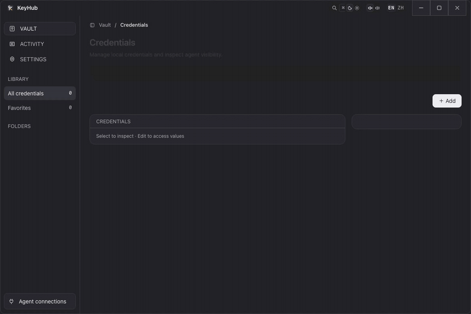

<p align="center">
  
</p>

# KeyHub

**Your agent does the work. Your hidden credentials stay local.**

KeyHub is a local credential manager and `stdio` MCP server for AI agents. Save a login, SSH key, API token, or custom secret once; let your agent use it to fill a focused field, run a command, or call an API without pasting the secret into a conversation.

Local first · MIT licensed · No KeyHub account · Windows / macOS / Linux

[简体中文](README.zh-CN.md) · [User guide](docs/guide.md) · [Security](SECURITY.md) · [Privacy](PRIVACY.md) · [Releases](../../releases)

> **Source status:** this checkout identifies as **0.16.0**. The KeyHub name and current source features do not imply a new published release. Check the assets and notes on the [releases page](../../releases) before downloading; build from source for this checkout's behavior.

## Demo

<p align="center">
  
</p>

<p align="center"><sub>Recorded against an isolated test vault with synthetic data. No real credentials are shown.</sub></p>

## Why KeyHub

- **One vault, several workflows.** Use composable modules for logins, SSH, API credentials, TOTP and environment variables.
- **Credentials without conversation copy-paste.** Hidden modules are resolved locally; per-module Agent visibility is an explicit disclosure choice.
- **A personal vault, too.** Organize cards, identities, secure notes, folders and favorites, with password generation, history and trash.
- **Browser companion.** Fill matching logins, review saves, use supported passkeys, and manually fill cards or identities from the same local vault.
- **Your data, your devices.** Encrypted local fields, password-protected desktop exports, optional encrypted snapshots in your own private GitHub repository.

There is no hosted KeyHub vault or remote MCP service. Optional GitHub backup is **manual snapshot backup and merge restore**, not automatic two-way sync.

## Quick start

1. **Open a compatible build.** Extract the platform package and keep its extension folder in place. On macOS, desktop input requires Accessibility permission; Linux desktop input supports X11.
2. **Connect your agent.** In **Settings → Agent connection**, connect a detected client, then start a new agent session.
3. **Save a credential.** Give the item a unique name, add the required modules, and leave sensitive modules hidden.
4. **Describe the task.** Name the KeyHub item when you know it; let the agent search only when discovery or clarification is needed.

```text
Use "Production Server" in KeyHub to check the service and show its status.
Use "DNS Provider" in KeyHub to list this account's domains.
If authentication is needed, check KeyHub before asking me for a secret.
```

KeyHub can detect, connect and repair **Codex, Claude Code, Cursor, OpenCode and OpenClaw**. Other clients can use a local `stdio` MCP configuration:

```json
{
  "mcpServers": {
    "keyhub": {
      "command": "/absolute/path/to/keyhub",
      "args": ["mcp", "stdio"]
    }
  }
}
```

Use the executable's actual absolute path: `/Applications/KeyHub.app/Contents/MacOS/keyhub` for a macOS app installed there, the portable `keyhub` launcher on Linux, or an escaped Windows path such as `C:\\Tools\\KeyHub\\keyhub.exe`.

To generate client-ready JSON or TOML, run the installed executable:

```sh
keyhub config stdio-json
keyhub config stdio-toml
```

For browser use, open **Settings → Browser Bridge** and install the bundled Chromium extension by dragging it onto the extensions page or using **Load unpacked**. Keep KeyHub and the bridge running. See the [browser guide](docs/guide.md#browser-ssh-and-api-behavior) for pairing, matching rules, reviewed saves and passkey limits.

## MCP surface

All **12 tools** use item names rather than internal UUIDs. An explicit item or unique search result selects the session's current project; compatible later actions may omit it. A managed terminal also keeps its own project binding.

| Tool | Purpose |
| --- | --- |
| `items_search` | Discover enabled items, including incomplete skeletons, modules and available actions |
| `items_create` | Create a new credential skeleton with blank, hidden secret slots for the owner to fill in the GUI |
| `credential_fill` | Fill one module into the focused browser, desktop or managed-terminal target |
| `terminal_run` | Run a one-shot local shell command with optional direct stdin |
| `ssh_run` | Run a remote command using a saved identity |
| `ssh_upload` | Recursively upload files or directories over SFTP |
| `ssh_download` | Recursively download files or directories over SFTP |
| `http_send` | Send authenticated HTTP requests, upload files or save responses |
| `terminal_start` | Start a managed interactive process |
| `terminal_write` | Send input to a managed terminal |
| `terminal_read` | Read redacted managed-terminal output |
| `terminal_stop` | Close a managed terminal |

Commands, stdin, paths, terminal input and HTTP fields can reference hidden modules with `{{keyhub:module name}}`; `secretEnv` injects modules when a child process needs environment variables. There is no unrestricted `get_secret` tool. Tool impact hints are descriptive, not authorization controls. See [calling conventions](docs/guide.md#mcp-calling-conventions).

For example, ask the agent to create an **ASR API** item with a public `url` and a blank `apiCredential` module. The owner then opens that item in the KeyHub GUI, fills the API token locally, and saves it without enabling Agent visibility. `items_create` accepts no secret values or visibility overrides, cannot update/delete existing items, and atomically rejects duplicate names without overwriting. An enabled skeleton is discoverable with `actions: []` until usable credentials are configured; disabled items stay absent. See the [request and owner-fill workflow](docs/guide.md#create-a-credential-skeleton).

After installing a binary that includes `items_create`, start a **new agent/client session** to load the updated tool list; an already-running stdio process keeps its existing tools. This documents source behavior, not confirmation that the updated binary is installed.

## Security boundaries

- **Hidden is not visible.** `items_search` excludes hidden values. Enabling **Agent visible** permits a module's value to enter agent context and provider logs; visible TOTP returns the current code, not its seed.
- **Encryption is not isolation.** XChaCha20-Poly1305 protects stored secret fields. Names, public purposes and folders remain metadata. KeyHub and the final target handle plaintext during use.
- **PIN is an owner-interface lock.** It protects GUI plaintext and extension access and verifies passkey requests; it is not a separate vault key and does not disable MCP actions.
- **The agent still has authority.** SSH commands are not restricted and SSH host fingerprints are not pinned. Saved HTTP URLs are defaults, not destination allowlists; redirects can cross origins. Transfers and saved responses can replace files.
- **Redaction has limits.** Known injected secrets are redacted, not every sensitive value a service or process might produce. Focused agent fill does not use the popup's website matching; `submit=true` can submit a form or press Enter.

KeyHub is **not a sandbox** and does not protect against a malicious agent, a compromised device/browser, or another process running as the same OS user. Read [SECURITY.md](SECURITY.md) before granting access to sensitive infrastructure.

### Local keys and backups

On macOS, current source uses an application-private **`master.key` file**, not a new Keychain-held key. It can migrate an accessible legacy Keychain key without prompting; if an existing vault's key cannot be recovered, startup refuses to create a replacement. Windows/Linux prefer system credential storage, with a file fallback. See [key migration and recovery precautions](docs/guide.md#migration-and-compatibility).

| Backup | Protection and recovery |
| --- | --- |
| Desktop `.mvault` export | Separate password, Argon2id and XChaCha20-Poly1305; no unlock key in the file |
| GitHub snapshot | Entire portable payload encrypted with a separate recovery key; keep that key outside the repository |
| Legacy / current CLI self-unlocking export | Includes unlock material; protect like plaintext credentials, **not** a cloud-safe encrypted backup |

Backups include password history and trash. Local deletion does not erase old backups or Git history. Losing the recovery key and every still-connected device makes a GitHub snapshot unrecoverable. [Backup and restore guide](docs/guide.md#github-encrypted-backup).

## Migration and capability parity

Previously **OpenKeylet**, originally **KRU**. The rename preserves credential capabilities and format identifiers; it does not provide stronger isolation or automatically rewrite every client configuration.

| Surface | Compatibility contract |
| --- | --- |
| Executable / MCP ID | Canonical `keyhub`; portable packages retain `openkeylet` and `kru` aliases |
| Local identity | App identifier `dev.kru.desktop` and data directory `mcp-vault/v2` stay unchanged |
| Environment | Prefer `KEYHUB_*`; supported `OPENKEYLET_*` and `KRU_*` overrides remain accepted |
| Templates | `{{keyhub:module}}`, `{{openkeylet:module}}` and `{{kru:module}}` resolve locally |
| Browser pairing | Fixed extension ID, token, protocol and storage keys remain compatible; the rename alone needs no re-pairing |
| Backups | Existing format/AAD identifiers, `openkeylet.vault.json` and recovery keys remain compatible |

For existing clients, choose **Settings → Agent connection → Repair**, then start a new agent session. Repair migrates recognized managed entries and executable paths; inspect unrelated or manually configured entries separately. Keep custom data-directory overrides pointed at the original vault.

**Back up before upgrading:** older vaults v7–v11 are read and saved as v12 on the next modification; portable backups now contain v8 data. Older applications cannot read these newer formats. The [guide](docs/guide.md#format-versions-and-importing-other-vaults) preserves Bitwarden/Chrome/Edge import rules and compatibility differences; it also lists data locations and macOS key migration steps.

## Development and builds

Requirements: **Rust 1.88+**, **Node.js 22+**, and the [Tauri 2 platform prerequisites](https://v2.tauri.app/start/prerequisites/). Run builds on the corresponding target OS.

```sh
npm ci
npm run dev          # Tauri desktop development
npm run lint         # Dependency-free static checks
npm run test:unit    # Node unit and contract tests; no browser needed
npm run check        # Rust type/build checks
npm test             # Rust tests
npm run docs:demo    # Re-record the README GIF from a synthetic vault (requires ffmpeg)
```

For UI and real-extension tests, install Playwright Chromium first:

```sh
npx playwright install chromium
npm run test:ui
npm run test:browser
npm run test:login-flows
npm run test:login-capture
```

`test:ui` exercises renderer flows with test fixtures; real-extension checks use isolated browser profiles and temporary vaults. They do not certify live website authentication or native desktop behavior. See [verification coverage](docs/guide.md#development-and-verification).

| Host / target | Build and package commands |
| --- | --- |
| Windows desktop | `npm run build` then `npm run portable` (Windows PowerShell) |
| macOS desktop | `npm run release:mac` (`build:mac` + `portable:mac`) |
| Linux desktop | `npm run release:linux` (`build:linux` + `portable:linux`) |
| Linux headless | `npm run release:headless` (`build:headless` + `portable:headless`) |

Portable archives and SHA-256 manifests are written to `dist/`. Headless builds omit the GUI/WebView, retaining MCP, SSH, HTTP, terminal, backups and browser bridge. Packaging a local build does not publish a release or establish signing/notarization status.

## Documentation

- [User guide](docs/guide.md): vault editing, browser setup, passkeys, SSH/HTTP behavior, backups and imports.
- [Security policy](SECURITY.md): threat model, execution authority, crypto formats and private vulnerability reporting.
- [Privacy policy](PRIVACY.md): local data, extension access and optional network services.
- [Browser extension distribution](docs/chrome-web-store/README.md): packaging and store-review documentation.

## License

[MIT](LICENSE). Copyright (c) 2026 KRU (now OpenKeylet) contributors.

KeyHub continues the OpenKeylet / KRU project. Existing contributor attribution and the MIT notice are preserved.
