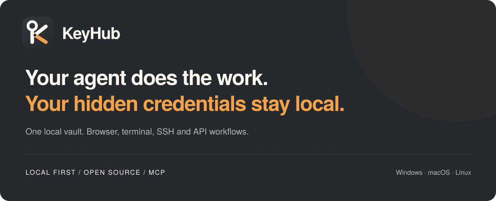
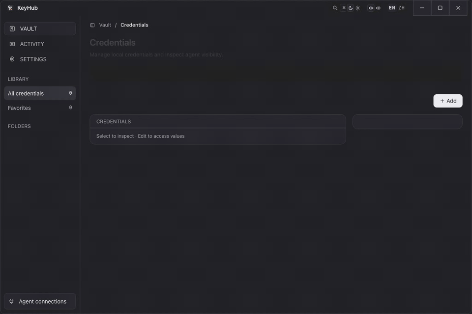

<p align="center">
  
</p>

# KeyHub

**让 Agent 继续工作，让隐藏凭据留在本机。**

KeyHub 是面向 AI Agent 的本地凭据管理器与 `stdio` MCP 服务。保存一次账号、SSH 私钥、API Token 或自定义秘密，即可让 Agent 用它填写聚焦输入框、执行命令或调用 API，无需把秘密粘贴进对话。

本地优先 · MIT 开源 · 无需 KeyHub 账号 · Windows / macOS / Linux

[English](README.md) · [使用指南](docs/guide.zh-CN.md) · [安全说明](SECURITY.zh-CN.md) · [隐私说明](PRIVACY.zh-CN.md) · [发布页](../../releases)

> **源码状态：** 当前代码版本仍为 **0.16.0**。KeyHub 名称与当前源码能力不代表新版已发布。下载前请核对[发布页](../../releases)的附件和说明；需要当前代码行为时，请从源码构建。

## 产品演示

<p align="center">
  
</p>

<p align="center"><sub>录制使用隔离的合成密码库，不包含任何真实凭据。</sub></p>

## 为什么用 KeyHub

- **一个密码库，覆盖多种任务。** 用模块组合账号、SSH、API 凭据、TOTP 与环境变量。
- **用凭据，而不是在对话中传凭据。** 隐藏模块在本地解析；打开某个模块的 Agent 可见开关，才允许披露该值。
- **也是个人密码库。** 整理信用卡、身份、安全笔记、文件夹与收藏，保留密码生成、历史和回收站。
- **共用密码库的浏览器伴侣。** 填写匹配账号、确认后保存、使用受支持的 Passkey，并手动填写信用卡或身份。
- **数据和设备由你掌握。** 字段本地加密，桌面导出支持独立密码，也可向自己的 GitHub 私有仓库保存加密快照。

KeyHub 不提供托管密码库或远程 MCP 服务。可选 GitHub 备份是**手动快照与合并恢复**，不是自动双向同步。

## 快速开始

1. **打开兼容构建。** 解压对应平台的软件包，并保留扩展目录。macOS 桌面输入需要辅助功能权限；Linux 桌面输入支持 X11。
2. **连接 Agent。** 在 **设置 → Agent 接入** 中连接检测到的客户端，再新建 Agent 会话。
3. **保存凭据。** 为项目取唯一名称，添加所需模块，敏感字段保持隐藏。
4. **直接描述任务。** 知道 KeyHub 项目名就写出名称；仅在发现或消除歧义时让 Agent 搜索。

```text
使用 KeyHub 中的「生产服务器」，检查服务并展示状态。
使用 KeyHub 中的「域名服务」，列出当前账号下的域名。
如果需要认证，先检查 KeyHub，不要让我把秘密发到对话里。
```

KeyHub 可检测、连接和修复 **Codex、Claude Code、Cursor、OpenCode、OpenClaw**。其他支持本地 `stdio` MCP 的客户端可手动配置：

```json
{
  "mcpServers": {
    "keyhub": {
      "command": "/absolute/path/to/keyhub",
      "args": ["mcp", "stdio"]
    }
  }
}
```

请使用真实可执行文件的绝对路径：macOS 安装在应用程序目录时为 `/Applications/KeyHub.app/Contents/MacOS/keyhub`；Linux 使用便携包的 `keyhub` 启动器；Windows 使用转义路径，例如 `C:\\Tools\\KeyHub\\keyhub.exe`。

也可用已安装程序生成客户端所需的 JSON 或 TOML：

```sh
keyhub config stdio-json
keyhub config stdio-toml
```

需要浏览器功能时，在 **设置 → Browser Bridge** 中将随包 Chromium 扩展拖入扩展管理页，或选择“加载已解压的扩展程序”。KeyHub 与桥接服务需要保持运行。[浏览器指南](docs/guide.zh-CN.md#浏览器ssh-与-api)说明配对、匹配规则、保存确认与 Passkey 限制。

## MCP 接口

全部 **12 个工具**使用项目名，而非内部 UUID。明确指定项目或得到唯一搜索结果后，会话会记住当前项目，后续兼容动作可省略名称；托管终端也保留自己的项目绑定。

| 工具 | 用途 |
| --- | --- |
| `items_search` | 发现已启用的项目（含未补全的骨架）、模块及可用动作 |
| `items_create` | 创建凭据骨架，秘密字段留空且隐藏，由所有者在 GUI 中填写 |
| `credential_fill` | 将一个模块填入聚焦的浏览器、桌面或托管终端目标 |
| `terminal_run` | 执行单次本地 shell 命令，可直接传入标准输入 |
| `ssh_run` | 使用保存的身份执行远程命令 |
| `ssh_upload` | 通过 SFTP 递归上传文件或目录 |
| `ssh_download` | 通过 SFTP 递归下载文件或目录 |
| `http_send` | 发送认证 HTTP 请求、上传文件或保存响应 |
| `terminal_start` | 启动托管交互进程 |
| `terminal_write` | 向托管终端发送输入 |
| `terminal_read` | 读取脱敏后的托管终端输出 |
| `terminal_stop` | 关闭托管终端 |

命令、标准输入、路径、终端输入和 HTTP 字段可用 `{{keyhub:模块名}}` 引用隐藏模块；子进程需要环境变量时可用 `secretEnv` 注入。没有不受限制的 `get_secret` 工具。工具影响提示不是授权机制。详见 [MCP 调用约定](docs/guide.zh-CN.md#mcp-调用约定)。

例如，让 Agent 创建 **ASR API** 项目，添加公开的 `url` 和留空的 `apiCredential` 模块。所有者再在 KeyHub GUI 中打开该项目，本地填写 API Token 并保存，不开启 Agent 可见。`items_create` 不接受秘密值或可见性覆盖，不能更新／删除已有项目；同名创建会原子拒绝，不覆盖原项目。已启用的骨架可被搜索到，但在配置可用凭据前返回 `actions: []`；已禁用项目仍不返回。详见[请求与所有者补全流程](docs/guide.zh-CN.md#创建凭据骨架)。

安装包含 `items_create` 的二进制后，需要启动**新的 Agent／客户端会话**才能加载更新后的工具列表；已经运行的 stdio 进程保留原工具。本说明描述源码行为，不代表已安装更新后的程序。

## 安全边界

- **隐藏不等于可见。** `items_search` 不返回隐藏值。打开 **Agent 可见** 后，值可能进入 Agent 上下文及模型提供方日志；可见 TOTP 返回当前验证码，不返回种子。
- **加密不等于隔离。** XChaCha20-Poly1305 保护保存的秘密字段；名称、公开用途和文件夹仍是元数据。执行时，KeyHub 与最终目标需要接触明文。
- **PIN 是所有者界面锁。** 保护 GUI 明文查看、扩展访问，并逐次验证 Passkey 请求；它不是独立密码库密钥，也不会关闭 MCP 动作。
- **Agent 仍具有执行权限。** SSH 命令不受限，也不固定主机指纹。保存的 HTTP URL 是默认地址，不是目标允许列表；重定向可跨来源。传输与响应保存可能替换文件。
- **脱敏并非全覆盖。** 只处理已知、注入的秘密，不能涵盖服务或进程新产生的所有敏感值。Agent 聚焦填写不执行扩展弹窗的网站匹配；`submit=true` 可提交表单或按回车。

KeyHub **不是沙箱**，不能防御恶意 Agent、被攻陷的设备／浏览器，以及同一操作系统用户下的其他进程。用于敏感基础设施前，请先阅读 [SECURITY.zh-CN.md](SECURITY.zh-CN.md)。

### 本地密钥与备份

macOS 当前源码使用应用私有 **`master.key` 文件**，而不是将新密钥放进 Keychain。可在不弹窗的情况下迁入可访问的旧 Keychain 密钥；已有密码库的密钥无法找回时，启动会拒绝生成替代密钥。Windows／Linux 优先使用系统凭据存储，不可用时回退到文件。详见[密钥迁移及恢复注意事项](docs/guide.zh-CN.md#迁移与兼容性)。

| 备份 | 保护方式与恢复要求 |
| --- | --- |
| 桌面 `.mvault` 导出 | 独立密码、Argon2id 与 XChaCha20-Poly1305；文件不包含解锁密钥 |
| GitHub 快照 | 独立恢复密钥加密完整便携数据；恢复密钥应另存于仓库之外 |
| 旧版／现有 CLI 自解锁导出 | 包含解锁材料，须像明文凭据一样保护，**不能**当作安全云端密文 |

备份包含密码历史和回收站；本地删除不会清除旧备份或 Git 历史。恢复密钥及所有仍连接的设备均丢失后，GitHub 快照无法恢复。详见[备份与恢复指南](docs/guide.zh-CN.md#github-加密备份)。

## 迁移与能力保持

KeyHub 原名 **OpenKeylet**，更早为 **KRU**。改名保留凭据能力及格式标识，不增强隔离，也不会自动改写所有客户端配置。

| 范围 | 兼容约定 |
| --- | --- |
| 可执行文件／MCP ID | 规范名称为 `keyhub`；便携包保留 `openkeylet` 和 `kru` 别名 |
| 本地身份 | 应用标识 `dev.kru.desktop` 与 `mcp-vault/v2` 数据目录不变 |
| 环境变量 | 优先使用 `KEYHUB_*`；受支持的 `OPENKEYLET_*` 与 `KRU_*` 继续接受 |
| 秘密模板 | `{{keyhub:module}}`、`{{openkeylet:module}}` 与 `{{kru:module}}` 均在本地解析 |
| 浏览器配对 | 固定扩展 ID、令牌、协议和存储键保持兼容；仅改名无需重新配对 |
| 备份 | 现有格式／AAD 标识、`openkeylet.vault.json` 及恢复密钥保持兼容 |

已有客户端请选择 **设置 → Agent 接入 → 修复**，随后新建 Agent 会话。修复仅迁移识别出的托管条目和可执行路径；无关或手动配置的条目需分别检查。自定义数据目录覆盖项应继续指向原密码库。

**升级前先备份：** v7–v11 旧密码库读取后，在下一次修改时写为 v12；新便携备份包含 v8 数据。旧程序不能读取这些新格式。[指南](docs/guide.zh-CN.md#格式版本与其他密码库导入)保留 Bitwarden／Chrome／Edge 导入规则及兼容性差异，并列出本地数据路径与 macOS 密钥迁移方式。

## 开发与构建

需要 **Rust 1.88+**、**Node.js 22+** 及 [Tauri 2 平台依赖](https://v2.tauri.app/start/prerequisites/)。请在对应目标操作系统上构建。

```sh
npm ci
npm run dev          # Tauri 桌面开发
npm run lint         # 无额外依赖的静态检查
npm run test:unit    # Node 单元与契约测试，无需浏览器
npm run check        # Rust 类型／构建检查
npm test             # Rust 测试
npm run docs:demo    # 从合成密码库重新录制 README GIF（需要 ffmpeg）
```

运行界面及真实扩展测试前，先安装 Playwright Chromium：

```sh
npx playwright install chromium
npm run test:ui
npm run test:browser
npm run test:login-flows
npm run test:login-capture
```

`test:ui` 使用测试夹具覆盖渲染界面；真实扩展测试使用独立浏览器配置及临时密码库。两者不代表真实网站认证或原生桌面行为已验证。详见[验证范围](docs/guide.zh-CN.md#开发与验证)。

| 主机／目标 | 构建与打包命令 |
| --- | --- |
| Windows 桌面 | 先 `npm run build`，再 `npm run portable`（Windows PowerShell） |
| macOS 桌面 | `npm run release:mac`（`build:mac` + `portable:mac`） |
| Linux 桌面 | `npm run release:linux`（`build:linux` + `portable:linux`） |
| Linux 无界面 | `npm run release:headless`（`build:headless` + `portable:headless`） |

便携压缩包与 SHA-256 校验清单输出到 `dist/`。无界面构建不依赖 GUI／WebView，保留 MCP、SSH、HTTP、终端、备份及浏览器桥接。打包本地构建不等于发布，也不证明已完成签名／公证。

## 文档

- [使用指南](docs/guide.zh-CN.md)：密码库编辑、浏览器安装、Passkey、SSH／HTTP、备份与导入。
- [安全说明](SECURITY.zh-CN.md)：威胁模型、执行权限、加密格式与私密漏洞报告。
- [隐私说明](PRIVACY.zh-CN.md)：本地数据、扩展访问及可选网络服务。
- [浏览器扩展分发](docs/chrome-web-store/README.md)：打包与商店审核材料。

## 许可证

[MIT](LICENSE)。Copyright (c) 2026 KRU (now OpenKeylet) contributors.

KeyHub 延续 OpenKeylet／KRU 项目，保留原有贡献者署名及 MIT 声明。
